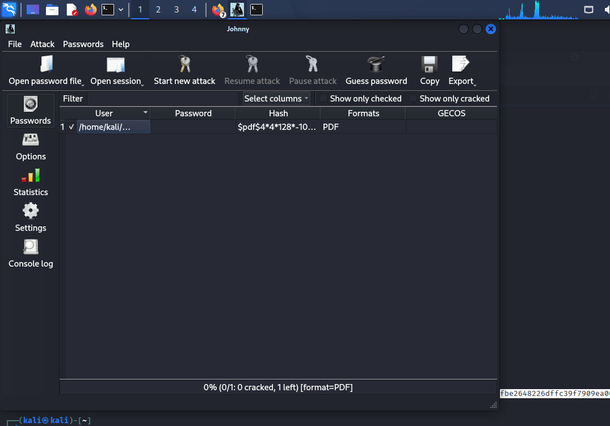
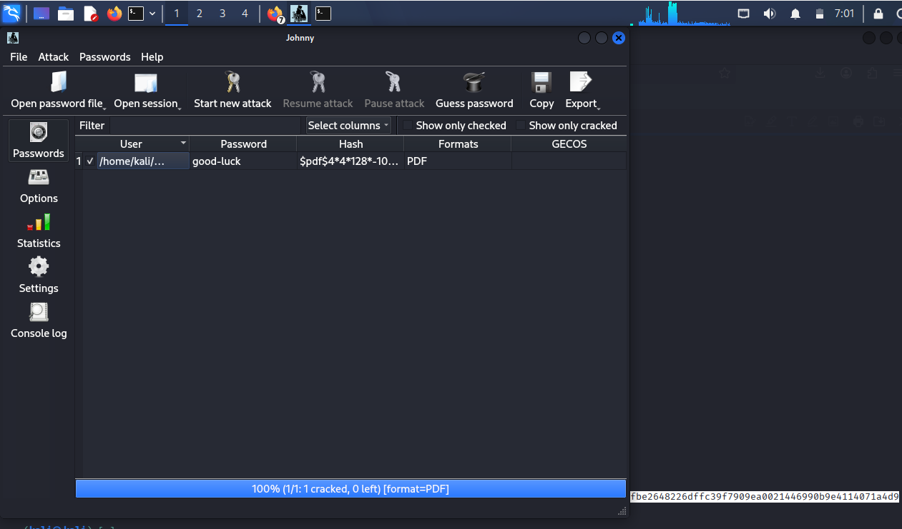
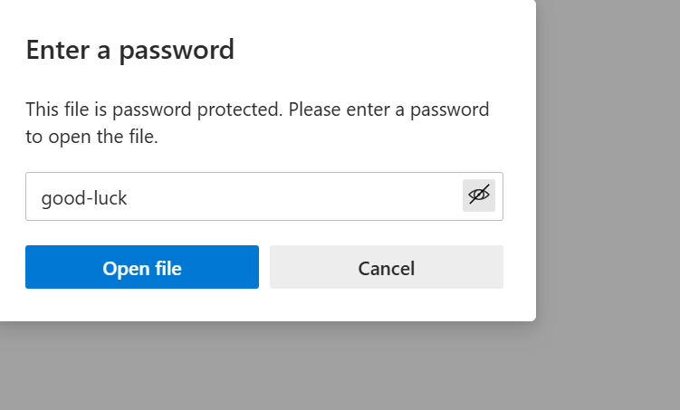
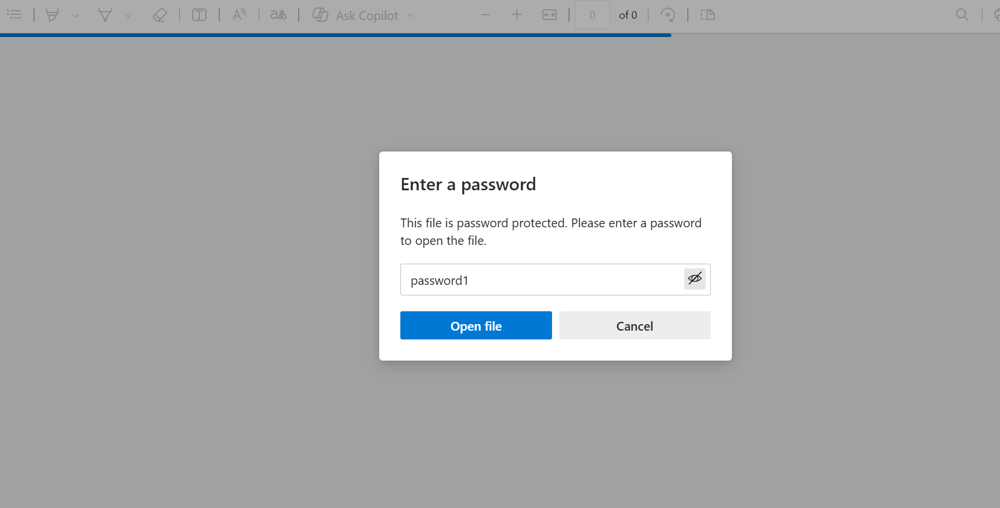
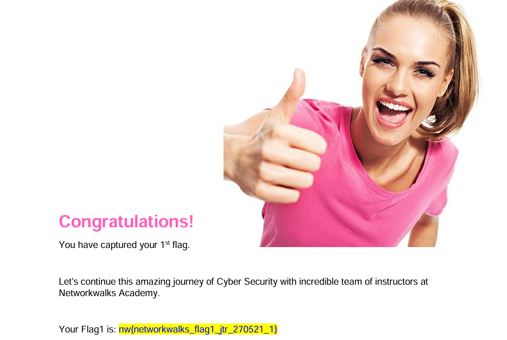

# Week 3 – Password Cracking Labs (PM1 & PM2)

**Internship:** Network Walks Cybersecurity Internship
**Batch:** B084
**Author:** Simra Shaikh
**LinkedIn:** [linkedin.com/in/simra-shaikh-92b987446](https://linkedin.com/in/simra-shaikh-92b987446)

## Objective

Crack the password of a protected PDF file (`My Locked PDF1.pdf`) using two different methods, and document the process with screenshots:

- **PM1** – Offline cracking using John the Ripper (JTR) + Johnny GUI, run inside a Kali Linux VM
- **PM2** – Online cracking using Network Walks' browser-based Hash Calculator and Password Cracker tools

---

## PM1 – Password Cracking with John the Ripper (JTR) + Johnny GUI

Run inside a **Kali Linux VM** (VirtualBox, NATNetwork 10.0.0.2/24) using John the Ripper and its Johnny GUI front-end, installed via:

```bash
sudo apt update
sudo apt install johnny john
```

### Steps

1. Downloaded `My Locked PDF1.pdf` directly inside the Kali VM (via Kali's own browser, avoiding host-to-VM transfer issues).
2. Located John's PDF hash extraction script:

   ```bash
   locate pdf2john.pl
   # /usr/share/john/pdf2john.pl
   ```

3. Extracted the hash from the PDF:

   ```bash
   perl /usr/share/john/pdf2john.pl ~/Downloads/"My Locked PDF1.pdf" > ~/hash1.txt
   cat ~/hash1.txt
   ```

   Output confirmed a valid hash starting with `$pdf$`:

   

4. Opened **Johnny** and loaded `hash1.txt` via **Open password file**. The table showed a single clean entry with format `PDF`.

   

5. Clicked **Start new attack**. Johnny ran John the Ripper in the background against the hash.
6. Attack completed — **100% (1/1 cracked)**.

   

7. **Cracked password:** `good-luck`
8. Opened the locked PDF in Edge and entered `good-luck` to unlock it successfully.

   

9. Lab completed — flag captured:

   ```
   nw{cybersecurity_flag_captured_2608}
   ```

   

---

## PM2 – Password Cracking with Networkwalks Tools

No installation required — runs entirely in the browser.

### Steps

1. Downloaded the locked PDF (`My Locked PDF1 (for NW Tools Lab WK3-PM2).pdf`) from the Network Walks lab page.
2. Opened the [Network Walks Hash Calculator](https://networkwalks.com/hash-calculator/) and uploaded the PDF under the **PDF** tab. The tool extracted a crackable hash in `pdf2john`/hashcat-compatible format, starting with `$pdf$...`.

   

3. Copied the full hash and pasted it into the [Network Walks Password Cracker](https://networkwalks.com/password-cracker/).
4. Ran the attack. The tool tried a dictionary of common passwords and found a match.

   

5. **Cracked password:** `password1`
6. Opened the locked PDF in Microsoft Edge and entered `password1` to unlock it successfully.

   

7. Lab completed — flag captured:

   ```
   nw{networkwalks_flag1_jtr_270521_1}
   ```

   

---

## Comparison

| | PM1 – JTR / Johnny | PM2 – Networkwalks Tools |
|---|---|---|
| Setup | Install John the Ripper + Johnny GUI | None – runs in browser |
| Hash extraction | `pdf2john.pl` (built into John) | Networkwalks Hash Calculator |
| Cracking | Johnny GUI attack (local) | Networkwalks Password Cracker (online) |
| Cracked password | `good-luck` | `password1` |
| Best for | Learning offline/local tools | Quick browser-based cracking |

## Tools Used

- Kali Linux (VirtualBox VM, NATNetwork)
- John the Ripper (1.9.0-Jumbo)
- Johnny GUI (2.2)
- Network Walks Hash Calculator & Password Cracker (web tools)

## Flags Captured

- PM1: `nw{cybersecurity_flag_captured_2608}`
- PM2: `nw{networkwalks_flag1_jtr_270521_1}`
